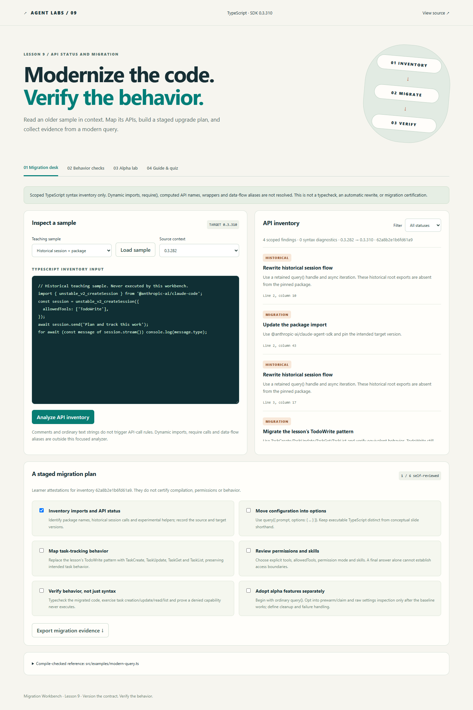
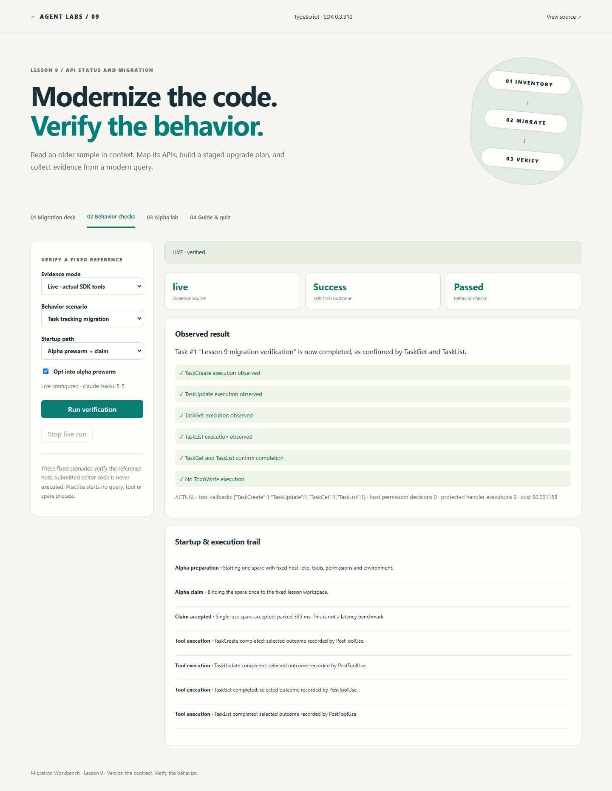

# Lesson 9 — Migration Workbench

A runnable companion to **Claude Agent SDK TypeScript 0.3.310**, Lesson 9: **API Status and Migration**.

Inventory an older TypeScript example, distinguish historical guidance from alpha APIs, build a staged migration checklist, and verify modern task tools and permission behavior. The app includes practice reports, actual SDK runs, opt-in prewarming, selected settings diagnostics, student exercises and a quiz.

## Start here

Requires Node.js **22.14+** or **24**, npm and a modern browser.

```sh
git clone https://github.com/luiscoco/claude-agent-sdk-lesson-09.git
cd claude-agent-sdk-lesson-09
npm ci
npm run dev
```

Open **http://127.0.0.1:4391**. Inventory and practice work without an API key. Begin with **Historical session + package**, click **Analyze API inventory**, then compare **Conceptual slide syntax** and **Modern query baseline**.



## What students will learn

- Separate historical patterns, lesson migration recommendations, recommended baselines and alpha APIs.
- Map the old package name and session flow to a modern `query()` host.
- Adapt conceptual slide syntax into the actual `query({ prompt, options: { ... } })` signature.
- Move the lesson's `TodoWrite` pattern toward `TaskCreate`, `TaskUpdate`, `TaskGet` and `TaskList`, then verify actual outcomes.
- Review permission strategy, tool availability, skills and cleanup alongside imports.
- Adopt `prewarm()` / single-use `claim()` and `resolveSettings()` deliberately, with failure handling and version context.

The full [classroom walkthrough](docs/walkthrough.md) includes exercises and instructor answers.

## Four work areas

| Area            | What it does                                                      | Evidence boundary                                                        |
| --------------- | ----------------------------------------------------------------- | ------------------------------------------------------------------------ |
| Migration desk  | Parses TypeScript and displays located API findings               | Scoped syntax inventory, not a full typecheck or codemod                 |
| Staged plan     | Records six learner review items by sample/version fingerprint    | Manual attestations, not runtime certification                           |
| Behavior checks | Runs fixed task-tracking or permission-denial scenarios           | Practice is synthetic; live uses actual SDK callbacks and outcomes       |
| Alpha lab       | Inspects selected settings fixture fields; explains prewarm/claim | Actual diagnostic settings helper; raw cascade is not an access decision |

Pasted code is **never executed, imported, written to disk or sent to a model**. The server parses it using the TypeScript 5.9.3 compiler API, installed under the pinned `typescript-compiler` npm alias. The project's TypeScript 7.0.2 CLI performs the actual repository typecheck; these are separate dependencies because that release's `typescript` package does not expose the earlier compiler API. Inventory results contain locations, fixed explanations and a fingerprint; exports omit the submitted source.

The analyzer recognizes direct named/renamed and namespace imports from the root SDK, `/core` and old root package. It detects historical session references, the lesson's TodoWrite tool-list pattern, alpha helpers and misplaced top-level query configuration. It does not resolve dynamic imports, `require()`, wrapper/data-flow aliases, computed names or lexical shadowing. It is a focused teaching inventory, not a complete migration tool. Findings can refer to both an import and its call. An empty inventory does not establish compatibility.

Checklist items are stored locally per code/version fingerprint. Editing the sample disables attestations until a fresh inventory is produced. The export records whether its audit is current, marks manual attestations explicitly, and keeps fixed-reference verification separate from the submitted code.

## The important version distinctions

The exact dependency is **0.3.310**; the supplied lesson spans **0.3.282–0.3.310**. Online documentation and later versions can have different exports and behavior.

- The current package is `@anthropic-ai/claude-agent-sdk`; the historical package name is `@anthropic-ai/claude-code`.
- The installed root package does not export `unstable_v2_createSession`; use a retained query handle and async iteration for the lesson's migration direction.
- **TodoWrite still appears in the installed built-in tool-name list.** The lesson recommends a task-tool migration; this repository does not claim TodoWrite was removed or attach an SDK deprecation annotation that is absent from that list.
- `prewarm()`, `SpareProcess.claim()` and `resolveSettings()` are **alpha** in the installed declarations. They are not required for the ordinary query baseline.
- Configuration belongs inside `options`. The slide's top-level `allowedTools` and `skills` are conceptual shorthand, not a directly executable 0.3.310 call.
- The examples use `skills: []`. A named skill such as the slide's `analysis` requires the corresponding available skill; this app does not invent or install one.

The fixed, compile-checked reference is [src/examples/modern-query.ts](src/examples/modern-query.ts):

```ts
const q = query({
  prompt: 'Create one migration-check task, complete it, read it, then list tasks.',
  options: {
    cwd,
    tools: ['TaskCreate', 'TaskUpdate', 'TaskGet', 'TaskList'],
    allowedTools: ['TaskCreate', 'TaskUpdate', 'TaskGet', 'TaskList'],
    permissionMode: 'default',
    skills: [],
    settingSources: [],
    persistSession: false,
    maxTurns: 8,
    maxBudgetUsd: 0.35,
  },
});
try {
  for await (const message of q) {
    if (message.type === 'result') return message;
  }
} finally {
  q.close();
}
```

The actual verification host adds ownership guards, permission checks, timeout handling and outcome assertions. The reference is not an automatic rewrite of student input.

## Live verification

Copy `.env.example` to `.env`, provide your own credentials, then restart the host:

```dotenv
ANTHROPIC_API_KEY=your-key-here
ANTHROPIC_MODEL=your-API-accessible-model-id
PORT=4391
```

Choose **Live** under Behavior checks. The ordinary query path is the default; prewarm requires an explicit alpha opt-in. Calls consume API credits. Each run has a $0.35 SDK budget, eight-turn limit, 90-second overall abort timer and, for prewarm, a 30-second initialization timeout. These limits are not a price quotation. The host admits one live verification at a time.

**Task tracking:** the real SDK creates one specifically named task, completes only that task, reads it, and lists tasks. Host hooks track the created ID, reject unrelated task reads/updates, and permit only the intended completion update. A report passes when all four tools were observed and both TaskGet and TaskList show that task completed. A successful final answer alone cannot pass the behavior checks.

**Denied capability:** the fixed prompt requests one protected MCP note. Its tool policy requests permission, the separate `canUseTool` callback denies it, and the fail-closed handler should never execute. A pass requires an observed host decision and zero protected-handler executions. No protected note contents or external operation are exposed.

Task tools write SDK task state under this app's ignored `.local/sdk-state` configuration directory. No shell, edit, general file-access or arbitrary task prompt is enabled. The live query's workspace is the bundled `fixtures/project` directory. Settings inspection uses a different fixture directory and never supplies live permissions. The host uses an explicit environment allowlist and keeps the API key on the Node side. `.env` and `.local` are ignored by Git and denied by Vite; the server binds to loopback and validates request host/origin and body bounds.

The SDK may emit `CLAUDE_SDK_CAN_USE_TOOL_SHADOWED`: the four task tools are intentionally pre-approved by `allowedTools`. Their input guards are in `PreToolUse`, while the separate protected scenario exercises the host permission callback. Logging alone grants no permission.



## Prewarm and claim

The optional real path calls root-package `prewarm({ options, initializeTimeoutMs })`, then claims the spare exactly once with the fixed session folder and selected model/permission mode. Host-level tools, hooks, environment, skills and settings sources are fixed at preparation. Credentials belong in preparation, not arbitrary claim-time environment values.

The host attaches a handler to `spare.claimed` before claiming or closing. A documented refusal such as `cwd_not_found` differs from `option_not_applied`: in the latter case, the prompt may already be running without a requested model/thinking option. The sample consumes the existing query rather than starting a duplicate. Other failed claims surface as failed runs, with guidance and cleanup. **There is no automatic cold retry.** Unit tests exercise refusal and already-running behavior with injected peers; actual prewarm success was verified separately.

The query and spare are closed in `finally`, alongside the MCP server, abort listener and timer. A spare is single-use; an unused spare also needs explicit close. Preparation timing in the event trail is an observation, not a claim that prewarming is always faster or a controlled benchmark.

## Settings inspection

The bundled project settings specify `model: 'lesson-fixture-model'`, default permission mode and a Bash deny entry. The local fixture overrides default mode with `dontAsk`. The fake model label is only a diagnostic fixture and is never used for live queries.

After opting in, the Alpha lab invokes the actual `resolveSettings()` with either project sources or project plus local sources. Only a selected projection is returned: fixture model label, raw mode, permission provenance source, presence of the fixture Bash deny and contributing source names. Host paths, environment values, other model names and rule contents are omitted.

The helper reports a **raw settings cascade, not authorization**. Managed tiers can still contribute even with restricted filesystem sources; the installed helper also has documented policy-helper and trust-filter caveats. This app does not interpret the raw mode as an approval or apply it to a query, so it does not need to turn the diagnostic result into policy. A managed installation can produce a different result from the bundled fixture's simple override.

## Commands and source map

```sh
npm run check                      # typecheck, unit/HTTP tests, production build
npm run api:check                  # actual pinned package export/name checks
npm run settings:inspect           # explicit alpha diagnostic; no model call
npx playwright install chromium
npm run test:e2e                   # production browser exercises
npm run live:smoke                 # billable real cold task verification
npm run live:smoke -- --permission  # billable denial scenario
npm run live:smoke -- --prewarm     # billable opt-in alpha task verification
npm start                          # serve the production build
```

For an existing local Chrome installation, PowerShell users can set `$env:PLAYWRIGHT_CHANNEL='chrome'` before browser tests. CI runs checks on Node 22 and 24 and browser exercises in Chromium, without an API key. Live verification is an explicit separate command.

| File                           | Responsibility                                                                    |
| ------------------------------ | --------------------------------------------------------------------------------- |
| `src/server/audit.ts`          | Parse-only TypeScript inventory and located findings                              |
| `src/shared/model.ts`          | Bounded schemas, teaching presets, checklist, guide and quiz                      |
| `src/server/verify.ts`         | Actual SDK task/permission scenarios, ownership guards, alpha startup and cleanup |
| `src/server/settings.ts`       | Actual alpha helper and selected-field diagnostic projection                      |
| `src/server/app.ts`            | Loopback HTTP/SSE API and single-run admission                                    |
| `src/client/main.ts`           | Interactive desk, manual review state, evidence export and verification UI        |
| `src/examples/modern-query.ts` | Minimal compile-checked migration reference                                       |

See [real verification evidence](docs/live-verification.md) for actual observed runs and their limits. Synthetic reports and learner checkboxes are not real execution evidence.

## Primary references

- [Official migration guide](https://code.claude.com/docs/en/agent-sdk/migration-guide) for the package rename and migration context.
- [Official TypeScript SDK changelog](https://github.com/anthropics/claude-agent-sdk-typescript/blob/main/CHANGELOG.md) for version-specific changes; the app's selected anchors are not a complete release history.
- Installed 0.3.310 `sdk.d.ts` and `sdk-tools.d.ts` for exact query, task, alpha helper, claim and settings contracts. These determine the executable code here.

MIT license. Public student repository; instructor credentials are not included.
