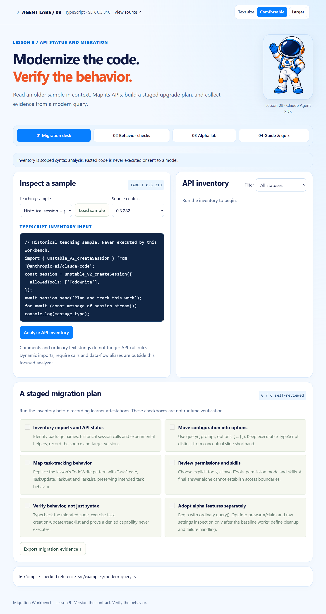

# Visual style and reading controls

This lesson uses the course reference style: a pale blue background, navy text, orange headings, blue navigation and controls, rounded panels, and the course astronaut mascot.

The default body size is 21 px. Choose **Larger** in the page header for a 24 px base size. Labels and helper text use a readable 18–20 px minimum at the default size; code uses approximately 20 px and wraps within its panel. Headings scale separately. The preference is saved locally for this application and remains after reload. No API call is made by the reading controls.

On smaller screens, navigation and work areas stack to give the larger text room. Native browser zoom remains available. Existing lesson actions, runtime settings and API behavior are unchanged.

Reference styling: [course Lesson 01 app](https://github.com/luiscoco/Udemy-Claude-Agent-SDK-lesson01-app) and [course Lesson 05 app](https://github.com/luiscoco/Udemy-Claude-Agent-SDK-lesson05-app). The astronaut asset is reused from the user-provided Lesson 01 reference repository. Original local screenshots of live runs elsewhere in the documentation remain historical execution evidence.
